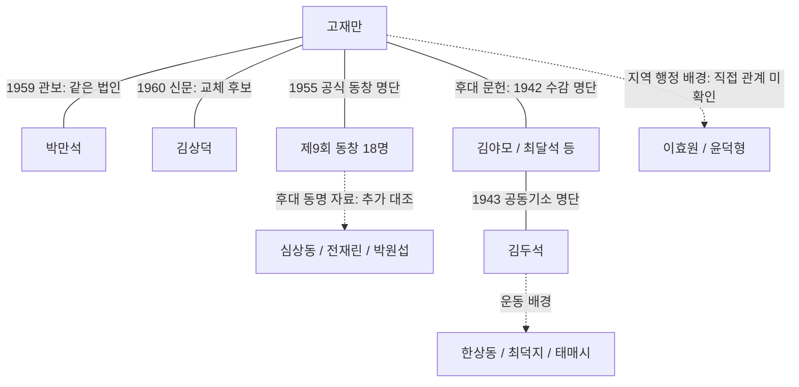

# 고재만 주변 인물 조사

2026-11-27 · 공개 사료 중심. [인물 등록부 CSV](PEOPLE_REGISTER.csv) · [추가 사료 조사](../sources/심층조사_2026-11-27.md)

## 관계 판정
A: 당대 관보·신문에서 관계 확인(기존 판독 포함). B: 공식 공동 소속 명부 또는 후대 연구문헌에서 같은 명단·공통 사건 확인; 직접 친분과 공동기소는 별개. C: 동시대 활동·기관 관련 단서, 직접 관계 미확인. D: 동명이인·이명·표기 충돌 등 미해결. 등급은 인물의 가치가 아니라 **고재만과의 관계 근거**를 나타낸다.

이번 웹 조사에서 일부 신문 상세 및 관보 뷰어는 접근 실패했다. 기존 보고서의 판독 내용을 출처와 함께 보존했으며 독립적으로 원문 재검증했다고 주장하지 않는다. 공개 등록부에 사적 주소·연락처·개인 신상 자료는 넣지 않는다.

## 1. 숭의원과 지역 행정

- 박만석(朴萬碩): [1959 관보](https://theme.archives.go.kr/viewer/common/archWebViewer.do?singleData=N&archiveEventId=0027983020)의 설립자·이사장과 고재만 감사가 동일 법인에 기재된다. [1960-06-28 마산일보](https://www.nl.go.kr/newspaper/detail.do?content_id=CNTS-00113046990)에서 고재만의 후임 이사장 취임 보도. 1956년 수리조합장·1961년 회화면장 동명 인물은 동일인 미확인. [1956 부산일보](https://www.busan.com/view/busan/view.php?code=19560905000064), [1961 부산일보](https://www.busan.com/view/busan/view.php?code=19610124000030). 원본 임원 이력서 확인 전 혼합하지 않는다.
- 김상덕(약종상): 같은 1960년 기사에 교체 후보로 등장. 취임 여부 미확인. 이상덕/이상석은 [1960-10-30 기사](https://www.nl.go.kr/newspaper/detail.do?content_id=CNTS-00113051624)의 제목·본문 표기 충돌. 배환갑은 [1963-09-09 기사](https://www.nl.go.kr/newspaper/detail.do?content_id=CNTS-00113097595)의 원장 취임 보도 인물. 별개 인물로 관리한다.
- 이효원과 윤덕형: [국가기록원 고성군 연혁](https://theme.archives.go.kr/next/organ/viewDetailInfo.do?code=OG0012863&isProvince=&mapInfo=mapno1)에 따르면 군수 교체는 1956-07-10. 후대 기록이 주장하는 7월 23일 허가는 윤덕형 재임기이다. 직접 허가·관여했다는 뜻은 아니다. 1956년 2월 [기부 보도](https://newslibrary.naver.com/viewer/index.naver?articleId=1956021600329203022)와 7월 허가를 서로 다른 재임기 문서로 추적한다.
- 유일업·김재만: [후대 연혁](https://m.blog.naver.com/hmi0419/220831547688)에서 초기 마을 형성에 언급된다. 김재만(金在萬)과 고재만(高在萬)은 구별한다.

## 2. 고려신학교 동창 18명

[고려신학대학원 1955년 제9회 공식 명단](https://www.kts.ac.kr/home/el_name/10?page=5&sod=desc&sop=and&sst=wr_datetime)은 고재만 포함 19명이다. 공동 명단은 학적 및 기수의 단서이며 실제 같은 반·개인 친분은 입증하지 않는다.

박원섭 · 서영수 · 심상동 · 우명준 · 이기진 · 장기목 · 전재린 · 정윤학 · 정효은 · 차문현 · 최준섭 · 최현선 · 최훈 · 추국원 · 홍신균 · 강순옥 · 서연신 · 최병애.

| 후대 자료의 동명 인물 | 확인 내용 | 판단 |
|---|---|---|
| 심상동 | [고신총회세계선교회 연혁](https://www.kpm.org/kpm%EC%95%88%EB%82%B4/%EC%97%B0%ED%98%81/): 1971~1972 선교부장, 1976·1979~1980 선교부 간사 기록 | 동창 본인 여부 학적·목사 안수록 대조 필요 |
| 전재린 | [피닉스장로교회 연혁](https://www.pkpchurch.org/church-guide/): 1974-07-28 고신 소속 목사로 교회 설립, 1979년 초대 담임 기록 | 1955년 졸업 기수 대조 필요 |
| 박원섭 | [공개 저자 약력](https://www.yes24.com/product/author/422096): 고려신학대학 졸업, 진주·대구·서울 지역 목회 경력 | 출판 유통 서지이므로 교단 기록 우선 대조 |

나머지 15명은 이름·동창 기수 외 개인 약력을 확정하지 않았다. 동창회 회보, 졸업앨범, 교역자 명부 및 노회록 순으로 조사한다.

## 3. 1942년 수감자 명단과 1943년 사건 연결

[최덕성 글 공개본](https://bsmilal2.tistory.com/entry/한상동과-주기철의-교회론)은 김두석 증언 67쪽을 근거로 1942-08-23 당시 수감자 중 고재만을 비롯한 여러 이름을 열거한다. 여기서 13명의 다른 이름을 등록했다: 박인순 · 김두리 · 김점용 · 강판례 · 김야모 · 최달석 · 김수용 · 김인식 · 서고분 · 조복희 · 박열순 · 김의순 · 고권식. 실제 수감 장소·수감 기간·공동 재판 여부는 확정하지 않는다. [독립기념관 김두석 인명사전](https://search.i815.or.kr/dictionary/detail/print.do?id=1787)과 대조하면 **김야모(金也模)·최달석(崔達碩)**은 1943-11-18 기소 관련 명단에도 등장한다. 이는 원판결 추적에 유용한 교차 인명이지 고재만의 공동기소를 증명하지 않는다. 김두석(1915~2004)의 창씨명 금전두석(金田斗石), 1944-09-12 부산지방법원 판결을 검색 축으로 삼는다. [한국민족문화대백과사전](https://encykorea.aks.ac.kr/Article/E0081103)에서 판결 제목을 확인했다.

동일 사건 주변 인물 이술연·염애나·김묘년·김수영 및 검사국 송치에 언급된 최성봉은 별도로 C 등급 등록. [국사편찬위원회 운동사](https://db.history.go.kr/modern/level.do?levelId=hdsr_008_0020_0060_0050) 및 [최덕지 관련 KCI 연구](https://www.kci.go.kr/kciportal/ci/sereArticleSearch/ciSereArtiView.kci?sereArticleSearchBean.artiId=ART001993879)는 경남 운동의 배경 자료다. 한상동·주남선·최덕지·태매시 등은 직접 접촉이 확인되기 전 배경 인물로 유지한다.

### 우선 열람
- [1993년 증언집](https://dl.nanet.go.kr/SearchDetailView.do?cn=MONO1199307761) 67·94쪽, [1985년 김두석 수기 목차](https://www.nl.go.kr/NL/search/nl_toc.ajax?viewKey=CNTS-00106935590&viewType=C&pageType=D) 검속·선고 관련 135쪽 이후 및 179~182쪽.
- [2014년 재판기록편](https://dl.nanet.go.kr/SearchDetailView.do?cn=MONO1201511731), 청구기호 275.1 -15-10 v.3: 1944-09-12 판결 원문·기소 명단, 사건번호 확인.
- 고신 1955년 제9회 학적부·졸업식 기록 및 1955~1957년 경남노회·시찰회 기록. 당동·화당·감서리·숭의원 교회 청원서와 파송 기록 확인.

## 4. 관계도 (검증 상태)

## 5. 조사 관리
등록부 50행은 기존 사료 및 이번 추가 검색을 통합한 인물 후보/표기 항목이다. 등급 B는 후대 증언 인용의 사실을 표시하며 원사료 검증이 완료됐다는 뜻이 아니다. 같은 인물 여부가 미확인된 별도 이름이나 표기는 통합하지 않는다. CSV의 후속검증 열에 따라 보완한다. 공개 출처만 수록하고 개인 의료·가족 정보는 제외한다.
